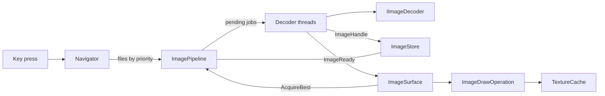

# Image pipeline

The app is built to get a sharp image on screen as soon as possible after a keypress, even in folders of very large pictures. The pipeline does this in three ways:

- It shows something immediately and improves on it, so each image can arrive in several quality tiers.
- It decodes the images you're likely to want next before you ask for them.
- It drops work that's no longer relevant, so a held arrow key can't build up a backlog.

## Overview

| Component | Responsibility |
|---|---|
| `Navigator` | Holds the file list and position, and works out which files matter most |
| `ImagePipeline` | Decides what to decode and in what order, and runs the decoder threads |
| `IImageDecoder` | Turns a file into pixels. `DecoderChain` tries each decoder in turn |
| `ImageStore` | Keeps decoded images in memory, within a byte budget |
| `ImageHandle` | A ref-counted lease on one decoded image |
| `ImageSurface` | Shows the best image available for the current file, and holds zoom, pan and rotation |
| `ImageDrawOperation` | Draws on the render thread |
| `TextureCache` | Keeps GPU textures for recent images |

`Pipeline/` and `Navigator` contain no Avalonia types, so this logic can be tested without a UI.

## Quality tiers

Each file can be held at up to three tiers, defined by `ImageTier`:

| Tier | Size | Purpose |
|---|---|---|
| `Instant` | At least 640×640, using the format's cheapest decode | Something to show right away |
| `Screen` | At least the size of the largest monitor | The sharp image for normal viewing. Resizing the window doesn't invalidate it |
| `Full` | The file's own resolution | Zooming in, or prefetched if images open at actual size |

Some formats have no cheap way to decode at a smaller size. The first probe records this for the file, and its `Instant` work becomes a `Screen` decode. An image decoded at its own size always counts as `Full`, whatever was requested.

## From keypress to image

1. `Navigator` moves to the new file and calls `SetWindow` with a priority list.
2. `ImagePipeline` replaces its whole pending list. Decodes already running are left to finish.
3. Decoder threads take jobs from the front of the list and add the results to `ImageStore`.
4. Each finished decode replans the pending list and raises `ImageReady`.
5. `ImageSurface` asks for the best image held for the file. The previous image stays up until something from the new file is ready.
6. As better tiers arrive, the surface swaps them in.

Startup uses the same path. `Program.Main` opens the file before Avalonia starts, because bringing up the UI takes longer than a scaled decode.

## Deciding what to decode

The priority list is the current file, the next file in the direction of travel, the file behind, and then up to three more ahead. If you reverse direction, the list reverses with you.

`ImagePipeline.Plan` turns that list into jobs:

- **Normal browsing:** `Instant` for the current file, then its prefetch tier, then the prefetch tier for the other files. The prefetch tier is `Screen`, or `Full` if the default zoom is actual size.
- **Rapid browsing:** when moves come less than 150 ms apart, every file gets `Instant` first and the current file gets sharp afterwards. Rapid mode ends when the pending list runs out, and prefetching resumes.
- **Zooming in:** when the view needs more detail than the current image has, `ImageSurface` calls `RequestFull`, and that job goes right after the current file's `Instant` job.

A job is skipped if the store already holds that tier or better, if the same job is queued or running, or if a better tier is already running for that file.

There's one thread per core, less one, between 1 and 8 threads.

## Memory

`ImageStore` holds images up to a budget of a quarter of RAM, to a maximum of 2 GB. It evicts by distance from the current image, not by last use, because what matters while browsing is what comes next. The furthest file goes first, and among equally far entries, the largest. The current file is never evicted, even if it's over budget on its own.

Adding a `Screen` or `Full` image removes that file's `Instant` image, which is no longer useful.

The render thread can still be drawing an image after it's evicted, so pixels are never disposed directly. Anything that uses an image takes a reference with `TryAcquire` and gives it back with `Release`, and the last release frees the pixels.

## Getting to the screen

A large image drawn from CPU memory costs over 100 ms per frame, so images are drawn as GPU textures. `TextureCache` keeps the four most recent.

- **Preloading:** once navigation has been quiet for 150 ms, `ImageSurface` uploads the next file's image, so its first frame is cheap too. It waits for a tier better than `Instant`, which would soon be replaced.
- **Shrinking:** textures have no mipmaps, which cuts first-draw time by about half. A shader averages samples when shrinking up to 6×, and mipmaps are only built past that.
- **Orientation:** EXIF orientation and rotation are transforms at draw time (`ViewGeometry`), so they never cost pixel work.

## Failures

A file that can't be read gets one retry after 100 ms if it looks locked, since it may still be being written or scanned. If it still fails, or won't decode, the pipeline stores the built-in `broken.png` for that file at `Full` tier, so a bad file shows a placeholder and isn't decoded again on every replan.

## Animation

Animations sit beside the pipeline. The first frame of a GIF or WebP goes through it like any other image, and then `AnimationPlayer` plays the current file using `AnimatedImage`, passing each frame to `ImageSurface.ShowFrame`. Frames stay out of `ImageStore`, so a long animation can't evict the images around it.
